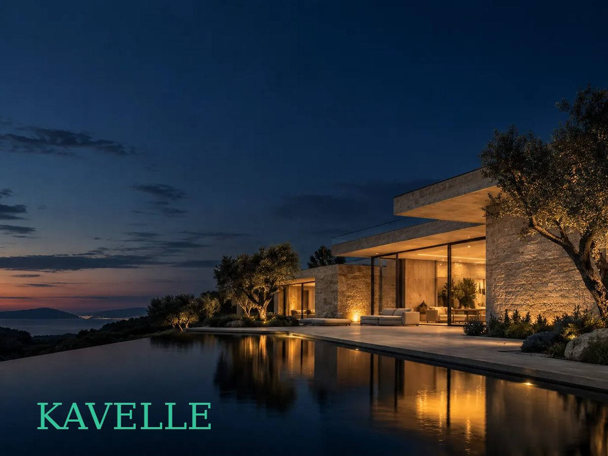

# Kavelle — free Hugo template with a working contact form

A dark one-page site for an interior design or architecture studio: a full-screen project slider, project categories, the studio philosophy, services, numbers and a contact form that sends to Formgong.



**Live demo:** https://kavelle.formgong.com · **Template page:** https://formgong.com/en/website-templates/kavelle/?utm_source=github&utm_medium=template&utm_campaign=kavelle-hugo

[](https://app.netlify.com/start/deploy?repository=https://github.com/formgong-hq/kavelle-hugo)
[](https://vercel.com/new/clone?repository-url=https://github.com/formgong-hq/kavelle-hugo)

## Features

- One-page, responsive, fonts bundled (no Google Fonts requests)
- Contact form that works without a server, powered by [Formgong](https://formgong.com/?utm_source=github&utm_medium=template&utm_campaign=kavelle-hugo&utm_content=features), a free form backend
- Spam protection (honeypot), success/error states from the real server answer
- Privacy page included · MIT licensed

## Quick start

```sh
hugo server   # http://localhost:1313
hugo          # static site in public/
```

The theme itself is `themes/kavelle/` and can be copied into any Hugo site (it reads `data/content.json` and falls back to its own copy). Hugo 0.156.0 or newer.

## Contact form via Formgong

The form posts straight to `https://formgong.com/submit`; no backend, no PHP, no serverless function.


1. Create a form at https://formgong.com/new and copy its access key.
2. Open `data/content.json` and replace `fk_your_access_key` (under `form.access_key`) with that key. Every text of the page lives in the same file.
3. The form sends `name`, `email`, `phone`, `service`, `message`, `subject`, `botcheck`. The page shows thanks only when Formgong answers `success: true`.

Submissions arrive by email (and optionally Telegram, Slack or Discord). Formgong has a free plan: [create a free form](https://formgong.com/?utm_source=github&utm_medium=template&utm_campaign=kavelle-hugo&utm_content=form-setup).

## Deploy

Build command: `hugo --minify` · Output directory: `public`. Works on Netlify, Vercel, Cloudflare and any static host.

## Files


```
data/
  content.json
themes/
  kavelle/
    data/
      content.json
    layouts/
      _partials/
        sections/  (8 files)
      baseof.html
      home.html
      list.html
      single.html
    static/
      fonts/  (7 files)
      img/  (13 files)
      site.css
      site.js
    LICENSE
    theme.toml
.gitignore
hugo.toml
LICENSE
```

## Images

The photos were generated for this template (ChatGPT image generation, OpenAI). The rooms, buildings and people are fictional. Replace them with your own work before launch.

## Fonts

Italiana, DM Sans: bundled as WOFF2 files (Latin and Latin Extended), no requests to Google Fonts. SIL Open Font License 1.1, the licence texts are next to the font files.

MIT license.

## License

MIT © Formgong. Demo names, texts and photos are fictional sample content. Questions: support@formgong.com
